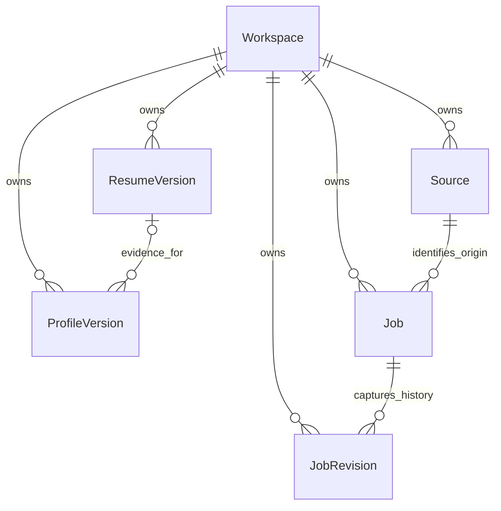

# Phase 2: database model and relations proposal

Status: awaiting approval before writing a Prisma schema or migration. This document proposes the design; it does not establish a database connection or enable any workflow.

## Decision requested

Approve six foundation tables on local PostgreSQL with Prisma: Workspace, ResumeVersion, ProfileVersion, Source, Job, and JobRevision. Use immutable versions for evidence-bearing content, explicit provenance for each important field, and restrictive deletion for referenced history. Create application, matching, and processing tables in later workflow migrations, using the relations outlined below.

## Scope after approval

Resolve and inspect compatible Prisma/PostgreSQL versions and their version-specific documentation before installing or writing the schema. Use npm and the existing strict TypeScript Next.js app. Prefer a local PostgreSQL Docker Compose service with its published port bound to 127.0.0.1, a persistent named volume, and credentials supplied through ignored environment files. An existing local PostgreSQL instance may instead be explicitly configured. Do not connect to, migrate, or reset an unidentified existing database.

Add a server-only Prisma client, Zod database configuration validation, migrations, and documented setup commands. Test against a separate disposable local test database; never run integration tests against the normal app database. Add a real connectivity/setup state in Settings, following DESIGN.md. Show a healthy database only after a successful real query. Keep workflow-dependent dashboard metrics unavailable until their queries and underlying workflows exist. No job import, upload, matching, application preparation, background jobs, source activation, or external submission is enabled by installing these tables.

## Foundation tables

All IDs are UUIDs. Each child carries workspaceId. All event/creation/update timestamps are PostgreSQL timestamptz and are serialized as UTC. Workspace is an ownership boundary for one local workspace, not authentication or permission to expose the app remotely.

| Table          | Responsibility and principal fields                                                                                                                                                                                                                                                                                                                                        | Relations                                                                                                                                                      |
| -------------- | -------------------------------------------------------------------------------------------------------------------------------------------------------------------------------------------------------------------------------------------------------------------------------------------------------------------------------------------------------------------------- | -------------------------------------------------------------------------------------------------------------------------------------------------------------- |
| Workspace      | Local workspace ID; timezone fixed to Asia/Kolkata; createdAt, updatedAt. No invented name, email, employment, or other personal facts.                                                                                                                                                                                                                                    | Owns all records. One real local workspace may be created during explicit setup; no personal-data seed.                                                        |
| ResumeVersion  | Immutable private document metadata: opaque storageKey, validated display filename, MIME type, byte size, SHA-256 content hash, version identity, createdAt; revokedAt for superseded/deleted availability. No file bytes or public URL.                                                                                                                                   | Workspace → many resume versions. Each profile version may refer to one selected resume version.                                                               |
| ProfileVersion | Immutable revision number, versioned facts JSONB, schemaVersion, createdAt, optional resumeVersionId. Structured profile facts include provenance and evidence, rather than a fabricated prefilled profile.                                                                                                                                                                | Workspace → many profile versions. Optional ResumeVersion → many profile versions. Latest revision is the current profile; consumers pin an explicit revision. |
| Source         | Workspace-local source identity, kind (manual input or official API/feed), provider label, optional public endpoint, terms URL/review timestamp, policy decision (not reviewed/allowed/blocked), and enabled=false by default. These are configuration/audit fields, not assertions about an employer.                                                                     | Workspace → many sources; Source → many jobs. No source records imply an authorized submission integration.                                                    |
| Job            | Stable job identity; sourceId; optional external source ID; optional exact validated listing URL and workspace-unique URL hash; discoveredAt; savedAt/dismissedAt/archivedAt; latestRevisionNumber. No application status on this table.                                                                                                                                   | Workspace → many jobs; Source → many jobs; Job → many job revisions.                                                                                           |
| JobRevision    | Immutable revision number, nullable original untrusted description (missing for URL-only intake), content hash, capturedAt, input method (user-pasted URL/description, user-imported file, or permitted API/feed), typed nullable job fields, and schema-versioned field provenance JSONB. Title, company, location, work arrangement, employment type, compensation, and experience requirements may be unknown. | Job → many revisions. Future matches and application drafts reference the exact revision used.                                                                 |

Resume ingestion and job intake will populate these tables in later phases. Phase 2 must not insert example resumes, profile skills, jobs, scores, applications, or counts.

A profile version is based on at most one selected resume version plus explicitly supplied/confirmed user facts. Supporting simultaneous evidence from several uploaded resumes is outside the initial model; add an explicit join table in that workflow if needed, rather than embedding uncontrolled resume IDs in JSON.

## Relation map

## Provenance and personal facts

The four provenance values remain verified, user-provided, inferred, and unknown, as defined in DESIGN.md. Profile facts use typed JSONB field envelopes; job revisions use typed nullable columns for common filters plus a mandatory JSONB provenance entry for every important column. The job-column values and provenance map are validated and written atomically. Extracted skills and individual experience/education entries also carry their own evidence, not just a blanket badge on the enclosing document.

Each evidence entry records provenance, basis (user entry, selected resume, employer/official source, deterministic rule, or AI), evidence locator within the stored revision/resume, and optional confirmation time and confirming actor. Unknown has a null value, no invented evidence, and no confirmation time. Verified requires user confirmation or an applicable official-source evidence record; AI or rule output alone cannot produce verified status. A URL by itself is never proof of a verified employer field. No remote fetch is needed merely to store a user-pasted URL.

Only the uploaded resume and user-verified profile can supply personal facts used for matching or drafting. Parsed resume claims remain traceable to the selected resume; inferred suggestions stay separate from confirmed claims until review. No Java/Spring Boot experience is prefilled or treated as confirmed. Legal, eligibility, demographic, disability, and veteran answers are never inferred. Missing sensitive answers retain the Needs your input state. Creating a new version is required when a field or its verification changes, so prior drafts cannot silently inherit new claims.

Zod validates every external input and each JSONB payload on the server. The relational schema and custom migration constraints enforce identities, foreign keys, enum values, timestamp invariants, and numeric bounds. Database checks also enforce the fundamental job-field/unknown relationship and required provenance keys; detailed nested evidence validation remains in the Zod write boundary. Direct database writes are not a supported app mutation path.

## Integrity, deduplication, and deletion

- Enforce unique (workspaceId, profile revision), (jobId, job revision), and (workspaceId, source identity). Require positive revisions and nonnegative resume sizes. Compensation, when known, uses decimal amounts with an explicit currency and period; no salary inference or currency conversion is implied. Experience requirements store employer-stated requirements separately from user experience.
- Use composite foreign keys including workspaceId so records from different workspaces cannot be linked, even accidentally. A job revision must belong to the job referenced by its parent; profile/resume relations must share the workspace.
- With a public source ID, deduplicate by (workspaceId, sourceId, externalId). With a supplied URL, use a unique hash of its validated exact URL within the workspace. Nullable IDs/hashes remain nullable; do not replace unknowns with empty strings. Reject a conflict between source-ID identity and URL identity for review rather than merging silently.
- Preserve URLs without stripping arbitrary query parameters, since parameters may identify different listings. Equivalent-looking URLs and identical descriptions are only potential duplicates, never automatic merges. Description-only entries retain independent identities; explicit merge support is deferred.
- Job.latestRevisionNumber references an existing (workspaceId, jobId, revisionNumber) using a nullable pointer until the first revision is inserted. Creation and revision updates use a transaction. The application write boundary ensures it points to the latest committed revision; database foreign keys ensure it points to the correct job.
- Use explicit restrictive foreign keys for source/job/revision/resume/profile history. Archive or revoke availability rather than cascading away evidence. Privacy deletion is a separate confirmed operation that removes private file contents and redacts derived personal data consistently, including historical drafts, while retaining only minimal nonpersonal audit metadata. Archival alone is not privacy deletion.
- File storage uses server-generated opaque keys under a private directory, never user-supplied paths or /public. Uploaded filenames are display metadata only. Type, size, traversal, and safe filename checks belong to the future upload endpoint. No filesystem path is exposed to the browser.

Initial indexes: workspaceId on each owned table; jobs by workspace/discoveredAt; savedAt, archivedAt, sourceId; revisions by job/revision; job revision title/company/location/work arrangement where required by filters. Avoid extra search infrastructure or indiscriminate JSON indexes until a real query needs them.

## Source policy and URL handling

LinkedIn and Indeed are manual-intake-only. Their names can identify a pasted listing, but their records must never enable crawling, API intake, or automated apply actions. Manual input is not permission to fetch the pasted page. Other API/feed sources remain disabled until their current official terms are checked and recorded in docs/SOURCES.md. If approved later, mirror that reviewed decision in Source and require both the recorded permission and enabled state before any network job is scheduled.

Future URL intake must validate HTTPS scheme, host, credentials, redirects, resolved addresses, and private/loopback/link-local/metadata ranges before any permitted fetch. Revalidate at the network boundary, not merely when inserting a URL. Job descriptions remain untrusted data and never become system instructions. This phase adds no fetching endpoints or source activation controls.

## Later workflow tables and relations

These are proposed extension points, not tables to create in the first Phase 2 migration.

| Future table     | Relations and invariant                                                                                                                                                                                                                                                                                                                                 |
| ---------------- | ------------------------------------------------------------------------------------------------------------------------------------------------------------------------------------------------------------------------------------------------------------------------------------------------------------------------------------------------------- |
| MatchResult      | Workspace, exact JobRevision, exact ProfileVersion; deterministic rule/version identifier, optional separate AI analysis, score bounded 0–100, evidence-backed explanations, createdAt. AI suggestions do not overwrite deterministic scoring or verified facts. A missing score remains missing, not zero.                                             |
| Application      | Workspace + Job, one application aggregate per job initially; preparation/tracking state, createdAt/updatedAt, optional actual appliedAt. Reapplication attempts can be added explicitly later rather than overwriting history.                                                                                                                         |
| ApplicationDraft | Application + pinned JobRevision/ProfileVersion/ResumeVersion; immutable draft revision; editable content captured as new revisions, proposed answers with provenance, unresolved inputs, and generation method. Draft readiness never implies submission.                                                                                              |
| ApplicationEvent | Append-only event history for an Application, previous/next state, actor type, recordedAt and optional occurredAt, user confirmation or permitted integration receipt metadata. State changes and events are written in one transaction. Applied requires real user confirmation or a trustworthy authorized integration receipt; no default appliedAt. |
| FollowUp         | Application + Workspace; dueDate as a local calendar date interpreted in Asia/Kolkata, optional completedAt in UTC. Unknown due dates stay null.                                                                                                                                                                                                        |
| ProcessingRun    | Workspace, workflow identity, idempotency key, actual startedAt/finishedAt and result state. Counters reflect completed persisted work only. Inngest execution is added later, with no Redis or separate service architecture.                                                                                                                          |
| DailyBudget      | Workspace + limit category + Asia/Kolkata localDate, actual usage and limit. Unique (workspaceId, category, localDate); reservation/increment in a transaction with concurrency protection. Do not derive daily usage from UTC calendar dates.                                                                                                          |

Job discovery/saving states stay distinct from application preparation/tracking states. Opening an original listing or preparing a draft creates no Applied event. Future application status corrections retain their event history. Any permitted integration will require a separately reviewed configuration and real interface test; adding a receipt field does not establish that an integration exists.

No match algorithm, AI call, source integration, status transition endpoint, Inngest execution, or daily-limit enforcement is claimed to work in Phase 2 merely because its future relation is described here.

## Time and counters

Store instants as timestamptz, with UTC session/serialization conventions. PostgreSQL converts timestamp-with-time-zone input to UTC and presents it using the session timezone; a calendar date is a separate type. See the [PostgreSQL date/time documentation](https://www.postgresql.org/docs/current/datatype-datetime.html).

For dashboard today and limits, compute the boundaries of the Asia/Kolkata calendar day and query the corresponding half-open UTC interval. Follow-up dates remain Asia/Kolkata calendar dates; do not reinterpret a date-only value through the browser's timezone. Event-recorded time and user-reported applied time are separate, so late confirmation does not silently backdate recorded activity.

A healthy connection with no rows may support a truthful zero for an implemented metric. Until a metric's workflow and query exist, retain Unavailable. Connection failures, absent configuration, and genuinely empty data remain separate states.

## Proposed implementation checks after approval

- Prisma model validation and migration validation using the installed version's tools; migration from an empty dedicated test database and regeneration of the TypeScript client.
- Real connection failure/success checks; verify missing configuration still permits the shell with an honest setup-needed state and invalid configuration fails without leaking credentials.
- Database integration checks for cross-workspace links, version uniqueness, revision-pointer integrity, required provenance/unknown constraints, source/URL deduplication, and restrictive deletion.
- Zod tests for evidence shapes and secret-safe environment errors. Boundary tests for Asia/Kolkata day intervals once date helpers are implemented.
- No data fixtures seeded into the normal database. Test fixtures remain confined to the disposable database and private temporary storage.
- npm run lint, npm run typecheck, npm test, and npm run build; report the results and stop before the next phase.

## Documentation basis

The proposal uses ordinary relational ownership and referential-integrity concepts from the [Prisma relational modeling documentation](https://www.prisma.io/docs/orm/data-modeling/relational-databases) and [Prisma referential actions documentation](https://www.prisma.io/docs/orm/v7/prisma-schema/data-model/relations/referential-actions). These are design references, not a declaration of an installed Prisma version. Prisma is not installed yet. Select the compatible stable version after approval and follow its matching docs before generating any schema/client or migration; do not copy APIs between major versions.

## Approval boundary

The supplied Phase 1 plan states: “Phase 2 begins with a proposed database model and relation design for your approval before any schema is written.” Approve this proposal to begin the schema, local database setup, migrations, and connectivity implementation described above. No schema has been written and no database has been modified.
